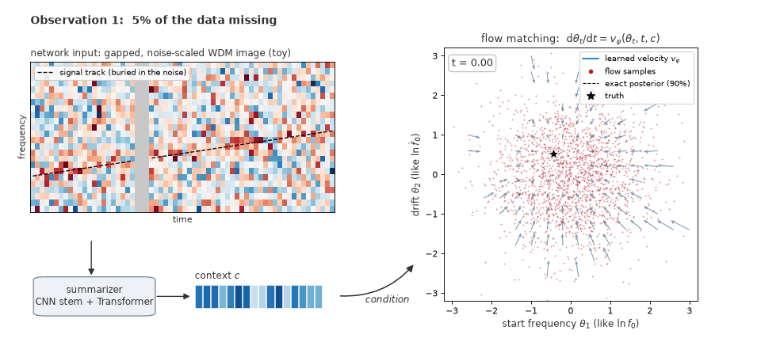

# Wavelet-domain flow matching for LISA signals with data gaps

Code for the model of the paper *Wavelet-domain flow-matching posterior estimation for LISA signals with
data gaps* (R. Mao, J. E. Lee, M. C. Edwards).

The method is amortized simulation-based inference for data with gaps. A gapped LISA time series is
mapped to a noise-scaled WDM (Wilson–Daubechies–Meyer) time–frequency image; a convolutional
stem and a Transformer compress the image into a context vector; and a flow-matching network,
conditioned on that context, transports Gaussian draws to the posterior. After training, the
posterior of a new observation takes seconds and needs no likelihood.

<p align="center"></p>

*A small version of the model trained on a toy problem (`toy/show_fm_wdm.py`, about one minute on a GPU).
The network sees a gapped, noise-scaled WDM image; the summarizer (CNN stem + Transformer) compresses it into
a context c; the flow-matching network v(θ_t, t, c) moves Gaussian samples to the posterior. One trained
network serves every observation; the dashed line is the exact posterior.*

## Contents

```
wdmsbi/                    the package
  config.py                settings of the paper: data length, WDM grid, prior, fixed source angles, network sizes
  waveform.py              Galactic-binary waveform and LISA TDI-A response (fastlisaresponse)
  wdm.py                   noise, gaps, WDM transform of the 1-5 mHz band, noise scaling of the rows
  networks.py              the summarizers and the flow-matching velocity network (JAX / Equinox)
  data.py                  stored waveforms, gap library, train/validation split
  flow.py                  posterior sampling (RK4)
  calibration.py           credible levels at which the truth enters a posterior
scripts/
  generate_waveforms.py    prior draws and their clean waveforms
  generate_gap_library.py  gap masks (lisaglitch)
  train.py                 trains a summarizer and the flow together
  calibrate.py             calibration on new observations
  simulate_observation.py  a gapped, noisy observation to try the network on
  sample_posterior.py      flow-matching posterior of one observation
toy/                       the illustration above
```

## Installation

```bash
git clone https://github.com/bpandamao/WDM_CNN_TRANSFORMER_SBI.git
cd WDM_CNN_TRANSFORMER_SBI
pip install -r requirements.txt        # the versions used for the paper
pip install -e . --no-deps
```

`requirements.txt` lists the versions used for the paper, with CUDA 12. Waveforms are generated on an NVIDIA
GPU through CuPy, so `fastlisaresponse` and `lisaanalysistools` need GPU support. Keep `lisaanalysistools`
at the pinned version: from version 1.1.12 its `A1TDISens` noise PSD is 1.7–3.3 times lower between 1 and
8 mHz, which changes the simulated noise without any error. For other CUDA versions, see the
[JAX installation guide](https://docs.jax.dev/en/latest/installation.html).

## Training the model

All settings default to those of the paper. Times are for one NVIDIA L40S GPU.

**1. Training data.** 30,000 clean waveforms (24,000 for training, 6,000 for validation) and a library of
1,000 gap masks. Only clean waveforms are stored; noise is added during training.

```bash
python scripts/generate_waveforms.py --n 30000 --seed 1 --output data/waveforms.h5
python scripts/generate_gap_library.py --seed 42 --output data/gap_library.h5
```

**2. Training** (about 28 h for the Transformer summarizer). Each step draws new noise and a mask from the
library for each waveform and computes the WDM images on the GPU. The noise scales of the WDM rows are
estimated once and saved with the weights.

```bash
python scripts/train.py --waveforms data/waveforms.h5 --gaps data/gap_library.h5 \
    --summarizer transformer --output runs/transformer
```

The two comparison summarizers of the paper share the flow-matching network and the noise scales of the
Transformer run: `token_pooling` keeps the convolutional stem and its tokens but replaces the Transformer
blocks with mean and max pooling, and `pooled_cnn` is a convolutional network with global average pooling.

```bash
for s in token_pooling pooled_cnn; do
  python scripts/train.py --waveforms data/waveforms.h5 --gaps data/gap_library.h5 --summarizer $s \
      --noise-scales runs/transformer/noise_scales.npy --output runs/$s
done
```

**3. Calibration** on 500 new observations whose waveforms and masks were not used in training. The masks
come from a second library, generated with the same gap model and another seed. Each network gets the same
observations and the same Gaussian draws; printed are, for each parameter, for (ln f0, ln fdot0) and for all
three jointly, the fraction of truths inside the 90% region and the KS p-value of uniform credible levels.

```bash
python scripts/generate_waveforms.py --n 500 --seed 20261027 --output data/calibration.h5
python scripts/generate_gap_library.py --seed 20261029 --output data/calibration_gaps.h5
python scripts/calibrate.py --injections data/calibration.h5 --gaps data/calibration_gaps.h5 \
    --runs runs/transformer runs/token_pooling runs/pooled_cnn --seed 20261028 --output calibration.npz
```

**4. Posterior of an observation.**

```bash
python scripts/simulate_observation.py --gaps data/gap_library.h5 --seed 7 --output observation.npz
python scripts/sample_posterior.py --run runs/transformer --observation observation.npz --output posterior.npz
```

## Using a trained network

```python
import jax, numpy as np
from wdmsbi import config, flow
from wdmsbi.networks import load

config.configure_jax()
model = load("runs/transformer/best.eqx", "transformer")
scales = np.load("runs/transformer/noise_scales.npy")
norm = np.load("runs/transformer/normalization.npz")

observed = np.load("observation.npz")["observed"]   # 1,572,864 samples, zeros in the gaps
theta = flow.sample(model, observed, scales, jax.random.PRNGKey(0), n=4000)
samples = flow.to_physical(theta, norm["param_mean"], norm["param_std"])  # log10 A, ln f0, ln fdot0
```

## Citation

```bibtex
@article{mao_wdm_flow_matching,
  title  = {Wavelet-domain flow-matching posterior estimation for LISA signals with data gaps},
  author = {Mao, Ruiting and Lee, Jeong Eun and Edwards, Matthew C.},
  year   = {2026}
}
```

The code for our earlier paper, *Robust and scalable simulation-based inference for gravitational wave signals
with gaps* ([arXiv:2512.18290](https://arxiv.org/abs/2512.18290)), is at
[bpandamao/SBI_gaps](https://github.com/bpandamao/SBI_gaps).

## License

MIT; see [LICENSE](LICENSE).
